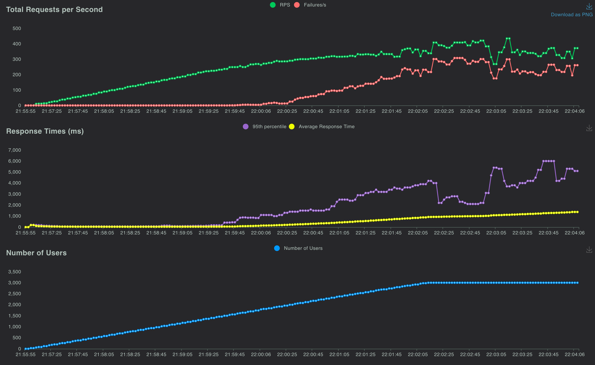
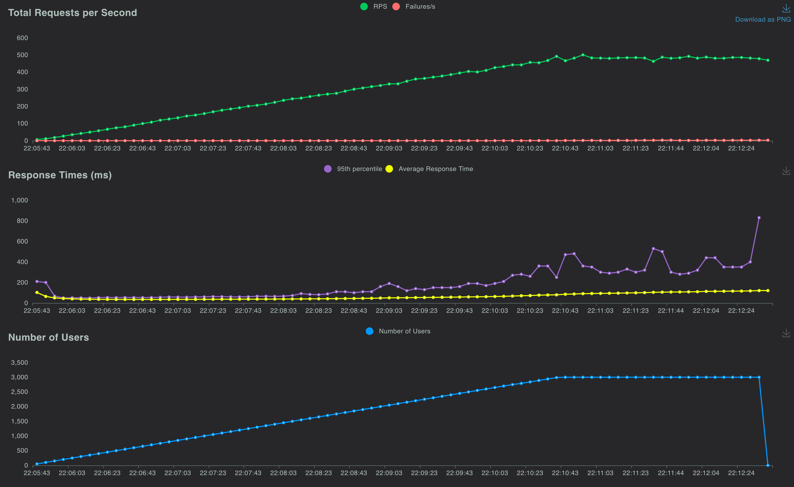
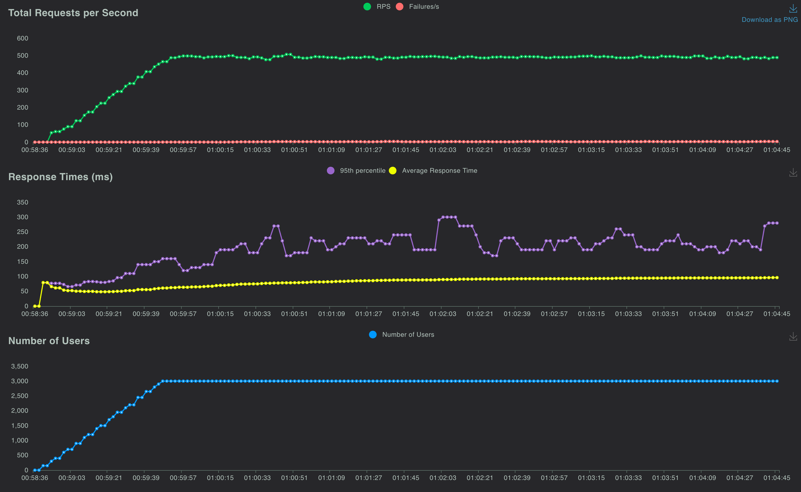

# Benchmarks

## Current core benchmark

The [service-free benchmark harness](benchmarks/README.md) measures direct operations and
`AsyncBatcher` with controlled batch sizes, concurrency, and bounded outstanding requests.
It records throughput, p50/p95/p99 latency, event-loop lag, a separate Python-memory sample,
warmup/repetitions, and the exact environment and commit. Start with:

```bash
uv sync --locked --no-default-groups --python 3.12
uv run --no-sync python -m benchmarks.core --output /tmp/async-batcher-core.json
```

Read its [method and interpretation limits](benchmarks/README.md#workload-and-baseline) before
comparing results. Async sleeps and thread sleeps model a fixed-cost bulk operation; they do not
predict the performance of a particular external service. No machine-dependent throughput gate
is enforced in CI.

The [7 November 2026 core report](benchmarks/results/2026-11-07-core-macos.md) includes a controlled
run on macOS/CPython 3.12, all trial metrics, variation between repetitions, and interpretation
limits. It measures the synthetic core workload, separately from the archived application runs.

## Current SQLite arrival benchmark

The [open-loop SQLite report](benchmarks/results/2026-11-07-sqlite-macos.md) compares direct
transactions, a simple application batcher, the library, and grouped-key batching on one writer.
It preserves all 36 trials and raw arrivals, including sparse-latency losses, overload rejections,
generator delay, and per-key tails. See the [reproduction guide](benchmarks/SQLITE.md) for the
bounded workload and common admission policy. These results are separate from the synthetic
core measurements and historical application runs.

## Historical application benchmarks

These are archived measurements from February/March 2024, originally labelled v0.1.0 and v0.2.0.
They are **not measurements of the current checkout**. The core implementation, dependency stack,
and example endpoints have since changed; `/predict` now offloads synchronous inference instead
of blocking the event loop. Do not use these numbers as current capacity or speedup guarantees.

The original notes report a MacBook Pro with an Apple M2 Max (12 cores), Uvicorn with 12 workers,
and a TensorFlow model taking approximately 11 ms per single prediction or 13 ms per 200-item batch.
Those model timings were not preserved as a separate reproducible microbenchmark.

### Recorded report totals

The table below uses aggregate values embedded in the saved Locust HTML reports. Failure percentage
is `num_failures / num_requests * 100`; response times are whole-run aggregates, not the final
sample in the throughput graphs. The reports include client timeouts and connection failures.

| Run | Duration | Requests | Failures | Failure rate | Mean latency | p95 latency |
| --- | --- | ---: | ---: | ---: | ---: | ---: |
| [v0.1.0 direct, 2024-02-18](assets/predict__report.html) | 7 min | 109,987 | 45,422 | 41.298% | 1,373.92 ms | 3,800 ms |
| [v0.1.0 batched, 2024-02-18](assets/optimized_predict__report.html) | 7 min | 133,568 | 285 | 0.213% | 121.00 ms | 300 ms |
| [v0.2.0 batched, 2024-02-29/03-01](assets/optimized_predict__report_v0.2.0.html) | 6 min | 164,351 | 768 | 0.467% | 96.26 ms | 200 ms |

The v0.2.0 notes used a `ThreadPoolExecutor(max_workers=12)` with batcher `concurrency=12` and
`max_queue_time=0.01`, and a different load ramp. These were not controlled comparisons with
identical server/client settings. In particular, worker and thread counts multiply across server
processes. The saved artifacts do not capture a complete environment or every invocation option.

### Archived throughput graphs

v0.1.0 direct endpoint:



v0.1.0 batched endpoint:



v0.2.0 batched endpoint:



### Measuring the current application example

Follow the [FastAPI example](examples/keras/README.md#load-testing). Run the direct and batched
endpoints separately with the same model, backend, worker count, inputs, client timeouts, and
load profile. Warm up inference first. Record the commit, Python/dependency versions, hardware,
batch limits, executor/concurrency settings, achieved throughput, latency percentiles, and failures.
Keep the generated HTML reports with those settings. No new performance result is asserted here.
