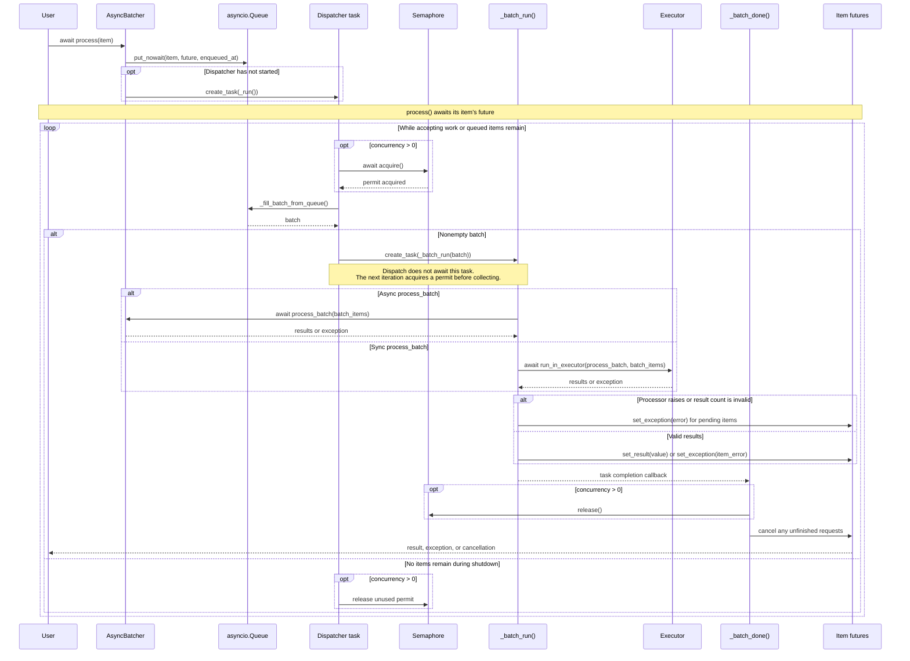

# AsyncBatcher - Asynchronous Batching for Python

## Overview
AsyncBatcher is a generic, asynchronous batch processor for Python that efficiently groups incoming items into batches
and processes them asynchronously. It is designed for scenarios where multiple requests or tasks need to be handled in
batches to improve efficiency and throughput.

## Key Features
- Generic typing: `AsyncBatcher[T, S]` describes input and output types.
- Asynchronous processing: Uses asyncio for non-blocking execution.
- Batching mechanism: Groups items into batches based on size or time constraints.
- Concurrency control: Limits the number of concurrent batch executions.
- Custom processing logic: Implement `process_batch` as an async method or a synchronous function run in an executor.
- Queue management: Uses an `asyncio.Queue` with optional capacity limits (`max_queue_size`).
- Error handling: Processor exceptions fail a batch; returned exception objects fail their corresponding items.

## How it works

### 1. Receiving Items for Processing
- Users call `process(item)`, which adds the item to an internal queue.
- `process(item)` is a coroutine: awaiting it enqueues the item and waits for its result.
- Use `asyncio.gather()` or `asyncio.create_task()` to submit multiple items concurrently.

### 2. Queue Management and Batching
- A dispatcher task continuously monitors the queue. `process()` starts it automatically.
  You can also start it explicitly with `await batcher.run()`, which waits for the dispatcher to finish.
  Shutdown waits for the dispatcher and batch work, not for the caller's later work.
- Items are collected into batches based on:
  - `max_batch_size`: Maximum items per batch, or `-1` for no limit.
  - `max_queue_time`: Time to collect a partial batch, measured from its oldest queued item.
    Busy processors can delay dispatch beyond this limit; queued items do not receive a fresh waiting period.
- A bounded queue rejects additional items with `QueueFullException` when it is full.
- The dispatcher acquires a concurrency slot before collecting the next batch, then starts its processing task.

### 3. Processing the Batch
- If `process_batch` is asynchronous, it is awaited directly.
- If `process_batch` is synchronous, it runs inside the configured `executor`, or the event loop's default executor.
- Each item's future is resolved with the corresponding result. A raised exception fails all pending items in that batch.
- Returning `None` resolves every item with `None`; returning the wrong number of results fails the batch.

### 4. Concurrency Control
- If `concurrency > 0`, a semaphore ensures that only a limited number of batches are processed simultaneously.
- `concurrency=-1` allows unlimited concurrent batches. The completion callback releases a limited concurrency slot
  even if its batch task was canceled before starting.

### 5. Stopping the Batcher
- `await stop()` rejects new items while draining, flushes partial batches, and waits for queued and active work.
- `await stop(timeout=seconds)` raises `asyncio.TimeoutError` if shutdown takes longer; accepted work continues draining.
  You can await `stop()` again or force cancellation. Canceling a caller awaiting `stop()` also leaves draining intact.
- `await stop(force=True)` cancels pending requests and waits for batch-task cleanup. Calling it repeatedly is safe.
  Synchronous functions already running in an executor cannot be interrupted and may still finish afterward.
  Restarting the batcher can overlap those still-running functions.
- Canceling one `process()` caller does not prevent other items in its batch from receiving results.
  Already accepted work may still execute, so cancellation does not guarantee that side effects are prevented.



## How to use

The library requires Python 3.11 or newer. Install it in your environment with pip:

```bash
pip install async-batcher
```

For repository development, use uv 0.13.7 with the committed `uv.lock`:

```bash
uv sync --locked --group lint
uv run --no-sync python -m pytest tests/core
```

This creates a project-local `.venv` with the default test group and lint tools. The core package
has no runtime dependencies. See [Contributing](CONTRIBUTING.md) for optional adapter environments,
integration services, and dependency updates.

### Keras optional dependency

The library and its optional adapters require Python 3.11 or newer. The `keras` extra requires
Keras 3.15.1 or newer and a separately installed backend. Keras 2 and older Keras 3 releases are not supported.

```bash
python -m pip install "async-batcher[keras]" jax
export KERAS_BACKEND=jax
```

Install and select your backend before importing Keras. TensorFlow 2.16.1+ and PyTorch are also supported
by Keras; consult the [Keras installation guide](https://keras.io/getting_started/) for backend setup.

When migrating from Keras 2, review the [Keras 3 migration guide](https://keras.io/guides/migrating_to_keras_3/).
Use the native `.keras` format for newly saved models. The bundled legacy HDF5 model is covered by a
prediction test with Keras 3 and the JAX backend; inference can load it with `compile=False` to avoid
restoring training configuration. Other backends and custom layers need application-specific validation.

Then, you can create a new `AsyncBatcher` class by implementing the `process_batch` method:

```python
import asyncio
import logging

from async_batcher.batcher import AsyncBatcher


class MyBatchProcessor(AsyncBatcher[int, int]):
    async def process_batch(self, batch: list[int]) -> list[int]:
        await asyncio.sleep(1)  # Simulate processing delay
        return [x * 2 for x in batch]  # Example: Doubling each item


async def main():
    batcher = MyBatchProcessor(max_batch_size=5, max_queue_time=2.0, concurrency=2)
    results = await asyncio.gather(*[batcher.process(i) for i in range(10)])
    print(results)  # Output: [0, 2, 4, 6, 8, 10, 12, 14, 16, 18]
    await batcher.stop()


# Set logging level to DEBUG if you want to see more details and understand the flow
logging.basicConfig(level=logging.DEBUG)
asyncio.run(main())
```

### Kinesis and Firehose

`AsyncKinesisBatcher` and `AsyncFirehoseBatcher` combine individual records into
native AWS batch requests, split requests by count and bytes, and retry partial
failures without resending acknowledged records. Install the `aws` extra and
provide a caller-owned asynchronous client. See the [usage and delivery semantics](docs/aws-streams.md).

### DynamoDB read consistency

`AsyncDynamoDbGetBatcher` uses eventually consistent reads by default. Set
`consistent_read=True` when each batch should use strongly consistent reads for all
requested tables. Retries of unprocessed keys preserve this setting.

```python
from async_batcher.aws.dynamodb.get import AsyncDynamoDbGetBatcher

batcher = AsyncDynamoDbGetBatcher(region_name="us-west-2", consistent_read=True)
```

Strongly consistent reads use more read capacity than eventual reads; see the
[DynamoDB read consistency guide](https://docs.aws.amazon.com/amazondynamodb/latest/developerguide/HowItWorks.ReadConsistency.html).

### DynamoDB projected reads

Use `projection_expression` and optional `expression_attribute_names` to select fields
for every table requested by a read batcher. Include **every primary-key attribute** as a
complete top-level field, using an alias when necessary. The batcher validates this before
opening a connection so it can match unordered responses to requests, including duplicates.
It returns the requested projection without adding hidden key fields. Nested document paths
and list indexes are forwarded to DynamoDB; retries preserve the projection and aliases.

```python
batcher = AsyncDynamoDbGetBatcher(
    projection_expression="#pk, #sk, details.#name, tags[0]",
    expression_attribute_names={"#pk": "partitionKey", "#sk": "sortKey", "#name": "name"},
)
```

Without a projection, reads still return all attributes. Projections reduce returned data,
but [do not reduce read capacity consumption](https://docs.aws.amazon.com/amazondynamodb/latest/developerguide/Expressions.ProjectionExpressions.html).

### Pinecone vector batches

Install `pip install 'async-batcher[pinecone]'` for Pinecone SDK 10.3 through 10.x.
The vector adapters use a caller-owned `pinecone.AsyncIndex` and one namespace per batcher:

- `AsyncPineconeUpsertBatcher`: accepts SDK `Vector` objects (dense, sparse or hybrid),
  returning `None` when the server acknowledges the write.
- `AsyncPineconeFetchBatcher`: accepts vector IDs and returns SDK `Vector` objects or `None`
  for missing IDs, preserving input order and duplicate requests.
- `AsyncPineconeDeleteBatcher`: accepts vector IDs and returns `None` after a successful call.
  Deleting a missing ID also succeeds.

```python
import asyncio

from pinecone import AsyncIndex, Vector
from async_batcher.pinecone import AsyncPineconeUpsertBatcher


async def write_vectors(host: str):
    # The SDK reads PINECONE_API_KEY from the environment.
    async with AsyncIndex(host=host) as index:
        batcher = AsyncPineconeUpsertBatcher(index=index, namespace="articles")
        try:
            await asyncio.gather(
                batcher.process(Vector(id="one", values=[0.1, 0.2, 0.3])),
                batcher.process(Vector(id="two", values=[0.4, 0.5, 0.6])),
            )
        finally:
            # Drain accepted work before the caller closes the shared index.
            await batcher.stop()
```

Use your index's actual vector dimension. These adapters target the SDK's
[vector interface](https://sdk.pinecone.io/python/how-to/vectors/upsert-and-query.html),
not schema-based document indexes. They batch upserts, fetches and deletes; similarity
queries and partial updates remain direct SDK operations.

Each dispatch makes one native SDK call. `max_batch_size` defaults to 100 and must be
between 1 and 1,000. Upserts also have a [2 MB request limit](https://docs.pinecone.io/reference/api/database-limits/operation-limits);
large vectors or metadata need a smaller batch size. SDK validation, size and service errors
fail that dispatch, with no extra adapter retries or rollback. Duplicate upsert IDs within
one dispatch are rejected before writing; use `concurrency=1` (the default) for sequential
dispatches, or separate awaited writes when repeatedly replacing the same ID. Fetches and
deletes deduplicate IDs within a dispatch.

Writes are eventually consistent: an acknowledgement does not guarantee immediate visibility
in a subsequent fetch or query, and deletion success does not establish that an ID existed.
The caller owns the index and must keep it open until every batcher using it has stopped.
The adapters never create, enter, or close the index.

### MongoDB ordered writes

Install the `mongodb` extra to use `AsyncMongoDbWriteBatcher` with **PyMongo 4.19+
and MongoDB Server 8.0+**. It uses PyMongo's native async client; Motor is not required.
Pass native `InsertOne`, `UpdateOne`, `UpdateMany`, `DeleteOne`, `DeleteMany`, or
`ReplaceOne` operations with a `namespace` such as `"app.items"`. A batch can target
multiple collections. Each caller receives its own `InsertOneResult`, `UpdateResult`,
or `DeleteResult`, including inserted IDs, upsert IDs, and matched/modified/deleted counts.
For upserts, inspect `did_upsert` and `upserted_id`. Native PyMongo 4.19 client-bulk
results include an upsert in `matched_count`, unlike collection-level update results;
the adapter preserves the driver's result objects.

```python
import asyncio

from async_batcher.mongodb import AsyncMongoDbWriteBatcher
from pymongo import AsyncMongoClient, InsertOne, UpdateOne


async def main():
    client = AsyncMongoClient("mongodb://localhost:27017")
    batcher = AsyncMongoDbWriteBatcher(client=client, max_batch_size=100)
    try:
        inserted, updated = await asyncio.gather(
            batcher.process(InsertOne({"_id": 1, "value": 0}, namespace="app.items")),
            batcher.process(UpdateOne({"_id": 1}, {"$set": {"value": 1}}, namespace="app.items")),
        )
        print(inserted.inserted_id, updated.modified_count)
    finally:
        await batcher.stop()
        await client.close()
```

Writes execute in order within each batch. Keep the default `concurrency=1` to
serialize batches. On a write error, earlier successful requests retain their results,
the failing request raises a PyMongo write error, and later requests in that batch
raise `MongoDbNotExecutedError`. Subsequent batches can continue. Ordered batches
are not transactions: earlier writes are not rolled back.

Network and write-concern errors fail the whole batch because individual outcomes
may be uncertain. The adapter adds no retries; PyMongo retains its own retry policy.
Unacknowledged writes (`w=0`) are rejected. The client belongs to the caller and must
be used on the batcher's event loop, then closed after stopping the batcher.

The [client bulk-write API](https://www.mongodb.com/docs/languages/python/pymongo-driver/current/crud/bulk-write/)
provides the per-operation results used here; older collection bulk writes only expose
aggregate counts. Run the live tests with `docker compose -f docker-compose/mongodb.yml up -d --wait`
and `pytest tests/integration/mongodb`; stop the service with
`docker compose -f docker-compose/mongodb.yml down --volumes`.
The test service pins MongoDB 9.0.4, which includes the
[Ubuntu kernel detection fix](https://jira.mongodb.org/browse/SERVER-131779) required by hosted CI runners.

## Configuration and results

- `max_batch_size` accepts a positive integer (including `1`) or `-1` for no limit.
- `concurrency` accepts a positive integer or `-1` for no limit.
- `max_queue_time` must be finite and nonnegative; `0` dispatches available items without a collection delay.
- `max_queue_size` limits buffered items; `-1` and `0` mean unlimited. A full queue raises `QueueFullException`.
- Each processor returns one result per input, in the same order. Returning `None` resolves every item with `None`.
  An exception raised by the processor fails the entire batch; an exception in the result list fails only that item.
- A batcher belongs to one event loop. After the dispatcher and worker completion callbacks finish shutting down,
  the next `process()` call automatically starts a fresh dispatcher on that same loop. While graceful draining or
  forced cleanup is still active, `process()` raises `RuntimeError("Batcher is stopping")`, including after a shutdown timeout.
  Prefer `try/finally` to ensure `await batcher.stop()` runs before closing application resources.
  Call `stop()` from outside `process_batch`.
  Invalid limits and unknown options raise during construction rather than being silently accepted.

## Benchmark

The benchmark is available in the [BENCHMARK.md](https://github.com/hussein-awala/async-batcher/blob/main/BENCHMARK.md)
file.

## When to Use AsyncBatcher?
The AsyncBatcher library is ideal for applications that need to efficiently handle asynchronous requests in batches,
such as:

### Machine Learning Model Serving
- Batch-processing requests to optimize inference performance (e.g., TensorFlow, PyTorch, Scikit-learn).

### Database Bulk Operations
- Inserting multiple records in a single query to improve I/O efficiency and reduce costs (e.g., PostgreSQL, MySQL,
  AWS DynamoDB). 

### Messaging and Network Optimization
- Sending multiple messages in a single API call to reduce latency and costs (e.g., Kafka, RabbitMQ, AWS SQS, AWS SNS).

### Rate-Limited API Calls
- Aggregating requests to comply with API rate limits (e.g., GitHub API, Twitter API, OpenAI API).

## Final Notes
- Implement `process_batch` according to your needs.
- Ensure `max_batch_size` and `max_queue_time` are configured based on performance requirements.
- Return per-item exceptions when only individual items should fail; otherwise a raised exception fails the batch.


## Kafka producer adapter

Install `pip install 'async-batcher[kafka]'` to use `AsyncKafkaBatcher` with aiokafka.
The adapter collects application requests into [native Kafka batches](https://aiokafka.readthedocs.io/en/stable/producer.html#direct-batch-control)
and groups them by an explicit topic and partition. The caller supplies and starts the producer:

```python
import asyncio

from aiokafka import AIOKafkaProducer
from async_batcher.kafka import AsyncKafkaBatcher, KafkaRecord


async def publish():
    producer = AIOKafkaProducer(bootstrap_servers="localhost:9092", enable_idempotence=True)
    await producer.start()
    batcher = AsyncKafkaBatcher(producer=producer, max_batch_size=100, max_queue_time=0.01)
    try:
        results = await asyncio.gather(
            *(
                batcher.process(KafkaRecord(topic="events", partition=0, value=value))
                for value in (b"first", b"second")
            )
        )
        print([(result.partition, result.offset) for result in results])
    finally:
        try:
            await batcher.stop()
        finally:
            await producer.stop()


asyncio.run(publish())
```

`KafkaRecord` accepts `topic`, `partition`, `key`, `value`, `timestamp_ms` (epoch milliseconds),
and `headers` (string/bytes-or-None pairs). A keyed `value=None` is a tombstone. Choose partitions
in your application; the adapter does not invoke the producer's partitioner. Key/value objects use
the supplied producer's serializers, which must be deterministic: a record can be serialized again
when it fills one native batch and is retried in the next.

The batcher's `max_batch_size` counts records. The producer's `max_batch_size` limits native batch
bytes; full builders are sent before remaining records are appended to a new builder. aiokafka can
accept an oversized first record into an otherwise empty builder. That record is sent alone, and a
broker size rejection fails that record without discarding successful neighboring batches.
`max_queue_size` and `max_queue_time` have the usual AsyncBatcher meanings. Keep `concurrency=1`
(the default) to retain per-partition order across separate application batches.

Each request returns its own aiokafka `RecordMetadata`, including its offset and timestamp.
CreateTime uses the individual record's timestamp; LogAppendTime uses the broker's timestamp.
Unknown offsets/timestamps remain unknown. With `acks=0`, the result is `None` and delivery is
unconfirmed. Validation, serialization, enqueue, and broker failures affect their corresponding
records; `asyncio.gather(..., return_exceptions=True)` lets callers inspect partial successes.
The adapter does not retry whole application batches or roll back successful records.

The caller owns producer start/stop, retries, acknowledgements, serializers, and transactions.
Stop the batcher before stopping the producer. Cancellation or `stop(force=True)` cannot retract
records already accepted by Kafka; pending producer deliveries continue and may succeed after the
caller is cancelled. Avoid blind resubmission when the delivery outcome is unknown.
