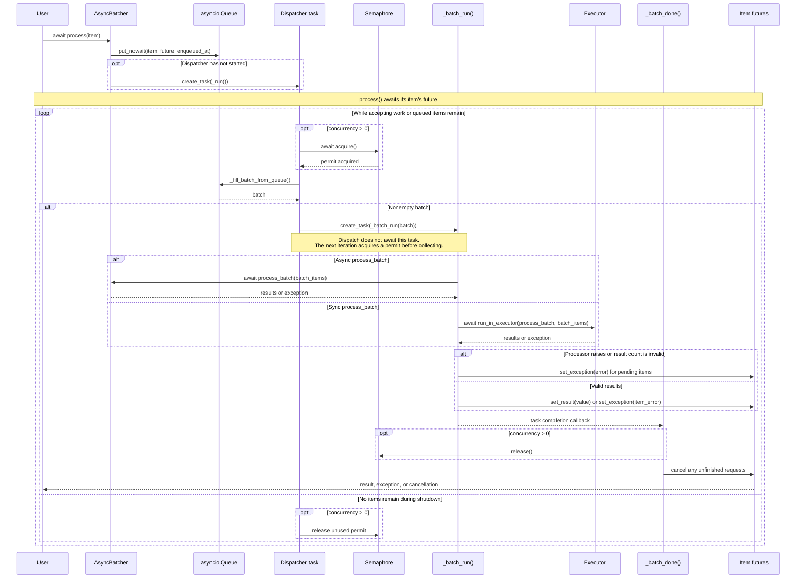

# Core API and lifecycle

This guide describes the current checkout. See [installation](../README.md#install) before running examples.
The public core imports are:

```python
from async_batcher import AsyncBatcher, AsyncBatchException, QueueFullException
```

`AsyncBatcher[T, S]` accepts items of type `T` and produces results of type `S`.
Override `process_batch(self, batch)` with an async method for asynchronous I/O or a regular
method for synchronous work. Use `process(item)` for normal submissions; calling `process_batch`
directly bypasses queueing, core limits, result validation, and shutdown tracking.

## Configuration

| Option | Default | Contract |
| --- | --- | --- |
| `max_batch_size` | `-1` | Positive integer or `-1` for unlimited items in one batch. Adapters can impose lower limits. |
| `max_queue_time` | `0.01` | Finite, nonnegative collection delay in seconds, measured from the oldest item's enqueue time. |
| `concurrency` | `1` | Positive number of simultaneously processing batches, or `-1` for unlimited. |
| `max_queue_size` | `-1` | Positive limit on buffered items; `-1` or `0` means unlimited. |
| `executor` | `None` | Same-interpreter executor for synchronous processors; `None` uses asyncio's default thread executor. |

A full queue raises `QueueFullException` immediately; it does not wait for space. The queue limit
does not include items already collected or processing. Applications choose whether to reject,
delay, or retry an overload response.

The dispatcher acquires a concurrency slot before collecting its next batch. A busy processor
can therefore delay dispatch beyond `max_queue_time`; this setting is not a request deadline.
Already queued items retain their original age. A zero delay collects available items without
waiting for more. With concurrent batches, completion order can differ from submission order.

Invalid limits and unknown options raise during construction. The legacy `batch_size` alias is
deprecated; use `max_batch_size`. `sleep_time` and `buffering_time` issue warnings and have no effect.

## Results and errors

Return an ordered, sized collection with exactly one result per input, in input order. Lists,
tuples, and suitable arrays work; generators, mappings, sets, strings, and byte containers do not.
The complete collection is validated before any request succeeds.

| Processor behavior | Caller outcome |
| --- | --- |
| Return one ordinary value per item | Each caller receives the corresponding value. |
| Return `None` | Every caller receives `None`. |
| Raise an exception | All pending callers in that batch receive the exception. |
| Return an exception at one result position | Only that caller raises the exception. |
| Return `asyncio.CancelledError()` at one position | Only that caller is cancelled. |
| Return the wrong count or an invalid collection | The entire batch fails. |

`StopIteration` results and a synchronous processor raising `StopIteration` become `RuntimeError`
with the original exception as their cause. When inspecting partial outcomes, use
`asyncio.gather(..., return_exceptions=True)` and handle the returned exceptions explicitly.
Adapter failures can occur after external side effects; a failed batch is not an automatic rollback.

## Lifecycle

- `await process(item)` enqueues the item and waits for its result, starting the dispatcher automatically.
- `await run()` explicitly starts a dispatcher and waits until shutdown. It is optional and is not
  a start-and-return call. A batcher cannot have two dispatchers; use `process()` for automatic restart.
- `await is_running()` reports whether the dispatcher is running or draining active batches.
- `await stop()` rejects new submissions during shutdown, flushes a partial batch, and waits for
  queued and active batch work. It does not wait for unrelated work a caller performs afterward.
- `await stop(timeout=seconds)` raises `TimeoutError` if the wait expires; accepted work keeps draining.
  Await `stop()` again or force cancellation. Cancelling a task awaiting `stop()` also leaves draining intact.
- `await stop(force=True)` cancels pending request futures and awaits batch-task cleanup. Repeated calls
  are safe. Cleanup can itself take time; the `timeout` argument also applies to a forced stop.

The first `process()`, `run()`, or `stop()` call binds the batcher to one event loop. It cannot
be moved to another loop, including after stopping. Once dispatcher and worker completion callbacks
finish, the next `process()` call automatically restarts it on the same loop. During graceful
draining or forced cleanup, submissions raise `RuntimeError("Batcher is stopping")`, including
after a shutdown timeout.

Keep `await batcher.stop()` in a `finally` block, as in the [quickstart](../README.md#quickstart).
Call it from outside `process_batch`: a processor or a child task cannot await its own shutdown.

Cancelling one `process()` caller does not cancel the other items in its batch. Its accepted work
may still execute, so neither caller cancellation nor forced shutdown guarantees that an external
write was prevented. Consult the adapter's delivery and retry semantics before resubmitting.

## Synchronous processors and executors

A regular `def process_batch` runs off the event loop in a thread executor. The batch worker's
`contextvars` context is copied into that call; this is one context per batch, not one per item.
An async processor must itself avoid blocking the event loop.

Use `ThreadPoolExecutor` or a compatible executor that runs in the same interpreter.
`ProcessPoolExecutor` and `InterpreterPoolExecutor` are rejected: batchers contain event-loop state.
You own an explicitly supplied executor; stop the batcher before shutting it down.

Python cannot interrupt a synchronous function already running in an executor. It may finish after
`stop(force=True)` returns, and restarting can overlap those still-running functions. Keep shared
resources alive until such functions finish when their cleanup matters.

## Dispatch sequence


