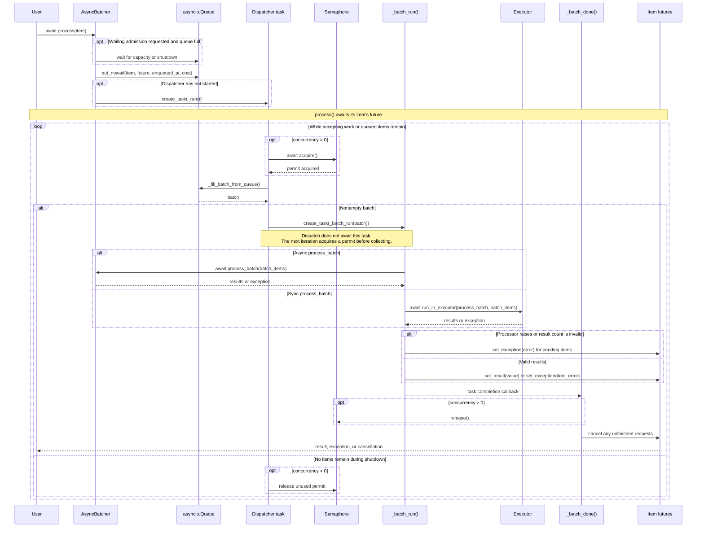

# Core API and lifecycle

This guide describes the current checkout. See [installation](../README.md#install) before running examples.
The public core imports are:

```python
from async_batcher import (
    AsyncBatcher,
    AsyncBatchException,
    BatchEvent,
    BatcherStats,
    CoalescingBatcher,
    GroupedBatcher,
    GroupLimitError,
    MapOutcome,
    QueueFullException,
)
```

`AsyncBatcher[T, S]` accepts items of type `T` and produces results of type `S`.
Use `AsyncBatcher.from_callable(processor, **options)` for an existing bulk function, or override
`process_batch(self, batch)` with an async method for asynchronous I/O or a regular
method for synchronous work. Use `process(item)` for normal submissions; calling `process_batch`
directly bypasses queueing, core limits, result validation, and shutdown tracking.

See [functions and contexts](functions.md), [bounded streams and queue admission](bulk-processing.md),
[cost budgets](cost-aware-batching.md), [statistics](observability.md), [grouped batching](grouped-batching.md),
[in-flight coalescing](coalescing.md), and the runnable [cookbook](cookbook.md) for focused examples.

## Configuration

| Option | Default | Contract |
| --- | --- | --- |
| `max_batch_size` | `-1` | Positive integer or `-1` for unlimited items in one batch. Adapters can impose lower limits. |
| `max_queue_time` | `0.01` | Finite, nonnegative collection delay in seconds, measured from the oldest item's enqueue time. |
| `concurrency` | `1` | Positive number of simultaneously processing batches, or `-1` for unlimited. |
| `max_queue_size` | `-1` | Positive limit on buffered items; `-1` or `0` means unlimited. |
| `max_batch_cost` | `None` | Optional positive finite per-batch budget; requires `item_cost`. Count and cost limits both apply. |
| `item_cost` | `None` | Synchronous nonnegative finite cost estimator, evaluated once per submission; requires `max_batch_cost`. |
| `on_batch` | `None` | Fast synchronous observer receiving one payload-free `BatchEvent` per completed dispatched batch. |
| `discard_cancelled` | `False` | Skip cancelled requests before dispatch; already dispatched work may still execute. Opt in for abandoned reads, retain the default for accepted writes. |
| `log_exceptions` | `True` | Include exception messages and tracebacks in library error logs. `False` emits fixed messages; caller exceptions are unchanged. |
| `processor_context` | `None` | Optional `contextvars.Context`, snapshotted at construction and copied for each dispatcher/worker. `None` inherits the initiating caller context. |
| `executor` | `None` | Same-interpreter executor for synchronous processors; `None` uses asyncio's default thread executor. |

A full queue raises `QueueFullException` immediately by default. Use
`process(item, wait_for_space=True, enqueue_timeout=seconds)` for optional bounded admission waiting;
the timeout covers queue admission only. [Map](bulk-processing.md) uses waiting admission and bounds
its own source consumption. Waiting producers are outside the shared queue limit, so creating an
unbounded number of waiting tasks still consumes unbounded memory.

The queue limit does not include items already collected or processing. An overflow item retained
for the next cost-limited batch still counts toward queue capacity. A cost above the batch budget
or an invalid estimator result fails only that submission, before enqueueing.

The dispatcher acquires a concurrency slot before collecting its next batch. A busy processor
can therefore delay dispatch beyond `max_queue_time`; this setting is not a request deadline.
Already queued items retain their original age. A zero delay collects available items without
waiting for more. With concurrent batches, completion order can differ from submission order.

Invalid limits and unknown options raise during construction. The legacy `batch_size` alias is
deprecated; use `max_batch_size`. `sleep_time` and `buffering_time` issue warnings and have no effect.

Treat settings as construction-only configuration. Directly assigning attributes is not a supported
reconfiguration API: for example, changing `concurrency` does not rebuild the existing semaphore.
Close intake, drain the old instance, and construct a replacement when limits or backend settings
must change. See [workload and metadata ownership](workloads.md).

## Results and errors

Return an ordered, sized collection with exactly one result per input, in input order. Lists,
tuples, and suitable arrays work; generators, mappings, sets, strings, and byte containers do not.
The complete collection is validated before any request succeeds.

| Processor behavior | Caller outcome |
| --- | --- |
| Return one ordinary value per item | Each caller receives the corresponding value. |
| Return `None` | Every caller receives `None`. |
| Raise an exception | All pending callers in that batch receive the exception. |
| Return an exception at one result position | Only that caller raises the exception. |
| Return `asyncio.CancelledError()` at one position | Only that caller is cancelled. |
| Return the wrong count or an invalid collection | The entire batch fails. |

`StopIteration` results and a synchronous processor raising `StopIteration` become `RuntimeError`
with the original exception as their cause. When inspecting partial outcomes, use
`asyncio.gather(..., return_exceptions=True)` and handle the returned exceptions explicitly.
Adapter failures can occur after external side effects; a failed batch is not an automatic rollback.

## Lifecycle

- `AsyncBatcher.from_callable(processor, **options)` wraps a bulk function with the same limits and result rules.
- `async with batcher` binds its loop and drains accepted work on exit, including an exceptional exit.
  Keep external client/executor contexts outside it. Context entry does not itself start a dispatcher.
- `await process(item, *, wait_for_space=False, enqueue_timeout=None)` admits an item and waits for its
  result, starting the dispatcher automatically.
- `map(source, *, max_pending=128, ordered=True)` returns a bounded async iterator. It yields in input
  order by default, or completion order with `ordered=False`; source/request errors fail iteration
  promptly. Use `contextlib.aclosing` when breaking early. Closing a map does not stop a shared batcher.
- `map_outcomes(source, *, max_pending=128, ordered=True)` uses the same bounded stream contract
  and yields indexed `MapOutcome` envelopes for successes and ordinary request errors. Source errors
  and cancellation still terminate iteration. Use `contextlib.aclosing` when breaking early.
- `await flush(timeout=None)` dispatches partial batches and waits for previously accepted work
  without stopping intake. Later submissions and admission waiters are outside its boundary;
  individual results still determine success. See [the flush contract](#flush-without-stopping-intake).
- `stats()` returns an immutable `BatcherStats` snapshot on the owning event-loop thread, without
  binding the loop or resetting counters. Counters survive stop/restart; gauges describe current work.
- `await run()` explicitly starts a dispatcher and waits until shutdown. It is optional and is not
  a start-and-return call. A batcher cannot have two dispatchers; use `process()` for automatic restart.
- `await is_running()` reports whether the dispatcher is running or draining active batches.
- `await stop()` rejects new submissions during shutdown, flushes a partial batch, and waits for
  queued and active batch work. It does not wait for unrelated work a caller performs afterward.
- `await stop(timeout=seconds)` raises `TimeoutError` if the wait expires; accepted work keeps draining.
  Await `stop()` again or force cancellation. Cancelling a task awaiting `stop()` also leaves draining intact.
- `await stop(force=True)` cancels pending request futures and awaits batch-task cleanup. Repeated calls
  are safe. Cleanup can itself take time; the `timeout` argument also applies to a forced stop.

The first `process()`, `run()`, `stop()`, `flush()`, or context entry binds the batcher to one event
loop. It cannot be moved to another loop, including after stopping. Once dispatcher and worker
completion callbacks finish, the next `process()` call automatically restarts it on the same loop. During graceful
draining or forced cleanup, submissions raise `RuntimeError("Batcher is stopping")`, including
after a shutdown timeout.

Use `async with`, as in the [quickstart](../README.md#quickstart), or keep `await batcher.stop()` in a
`finally` block when you need an explicit timeout or force policy.
Call it from outside `process_batch`: a processor or a child task cannot await its own shutdown.

`GroupedBatcher(factory, group_key=..., max_groups=128, idle_timeout=60)` owns separate fresh child
batchers for compatible keys. Idle children are drained before their slots are reused; if every
slot is busy, a new key raises `GroupLimitError`. Its `stop()` permanently closes the manager,
unlike an individual batcher's automatic restart. See [group ownership and shutdown](grouped-batching.md).

Cancelling one `process()` caller does not cancel the other items in its batch. Its accepted work
may still execute, so neither caller cancellation nor forced shutdown guarantees that an external
write was prevented. Consult the adapter's delivery and retry semantics before resubmitting.

## Synchronous processors and executors

A regular `def process_batch` runs off the event loop in a thread executor. The batch worker's
`contextvars` context is copied into that call; this is one context per batch, not one per item.
An async processor must itself avoid blocking the event loop.

Use `ThreadPoolExecutor` or a compatible executor that runs in the same interpreter.
`ProcessPoolExecutor` and `InterpreterPoolExecutor` are rejected: batchers contain event-loop state.
You own an explicitly supplied executor; stop the batcher before shutting it down.

Python cannot interrupt a synchronous function already running in an executor. It may finish after
`stop(force=True)` returns, and restarting can overlap those still-running functions. Keep shared
resources alive until such functions finish when their cleanup matters.

## Dispatch sequence



## Processor context and request metadata

By default, the dispatcher inherits the context of the caller that starts it. Later
batches inherit that dispatcher context, including when submitted by different callers.
A request ID or tenant stored in a `ContextVar` is therefore not per-item metadata.
The same rule applies to synchronous processors and batch observers.

Pass `processor_context=contextvars.Context()` for an empty service context, or a
context prepared during application startup for explicit service-level values. The
batcher snapshots it at construction and copies it for each worker; changing the
original context later or rebinding a value inside one worker does not affect another.
Context copies do not deep-copy their values; mutable objects remain caller-owned.
Internal ancestry used to reject self-shutdown remains intact. Admission callbacks
such as `item_cost` still execute in their caller's context.

Carry request-specific identity and tracing data explicitly in input records. Build
compatibility keys from authenticated server-side identity and processing options;
grouping does not authenticate a caller. Snapshot mutable nested input values before
submission when later mutation could change routing or invalidate a cached cost.

## Flush without stopping intake

`await batcher.flush(timeout=None)` dispatches partial batches and waits for all work
accepted before the flush coroutine starts running. Requests still waiting for queue
capacity and later submissions are outside that boundary. Intake stays open, so a
shared service can flush one checkpoint without stopping or restarting its dispatcher.
For a producer-owned checkpoint, finish submitting its intended items before flushing;
merely creating submission tasks does not mean they have been accepted.

Completion includes batch-task cleanup even when a caller cancelled its result.
Inspect the individual results or `map_outcomes()` to determine success: flush does
not guarantee that every item succeeded, provide a database transaction, or establish
backend durability. Running batches retain their configured concurrency limit.

A timeout or cancellation stops only the flush wait. Accepted work continues. Graceful
shutdown can finish a pending flush; forced shutdown interrupts it with `RuntimeError`
because cancelled executor awaits cannot prove their native functions have finished.
A flush started after cleanup with no remaining accepted work returns immediately.
Calling flush from the batcher's processor or its active descendants raises instead of
waiting on itself. Like processing and shutdown, flush binds the owning event loop.

## Discard cancelled reads before dispatch

Set `discard_cancelled=True` for reads or inference where an abandoned request should
be omitted if it has not been dispatched. The default is `False`, preserving accepted
write processing after caller cancellation. The dispatcher skips cancelled queue and
cost-carryover entries, then checks the collected batch again before creating its
worker. No empty processor call or batch event is emitted when every item is skipped.
A partially collected batch can still wait for its collection deadline or a flush;
skipped items can leave unused budget and do not trigger repacking.

This policy does not cancel a running backend operation or retract side effects.
Cancellation after dispatch may still reach the processor. Use application deadlines
(such as `asyncio.timeout`) for the caller's response budget and a separate backend
timeout for backend work. `flush()` treats skipped entries as completed cancelled work,
while accepted/cancelled statistics retain them. Group managers and coalescing wrappers
shield their owned child submissions, so cancelling a wrapper caller does not cancel
that underlying request and does not activate this child policy by itself.
